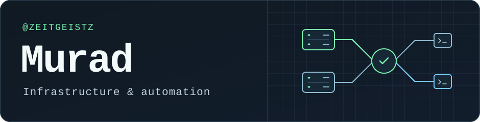

<picture>
  
</picture>

I’m an IT infrastructure specialist. I work with Windows and Linux servers, Active Directory, and VMware, and I build tools that take repetitive work out of IT operations.

## Selected projects

| Project | What it does |
| :--- | :--- |
| **[ServiceDesk](https://github.com/zeitgeistz/servicedesk/tree/main/src)** | Multi-tenant IT support app with ticket queues, SLA tracking, asset inventory, and Active Directory integration. |
| **[IDM Auto Sorter](https://github.com/zeitgeistz/idm)** | Chromium extension that sorts downloads by rules and gives you a dashboard for finding and managing files. Includes a [PowerShell sorter](https://github.com/zeitgeistz/idm/blob/main/Organize-Downloads.ps1) for existing downloads. |

## What I work with

- **Systems** · Windows Server, Ubuntu, Active Directory, Group Policy
- **Infrastructure** · VMware ESXi and vCenter, VLANs, VPNs, backup and recovery
- **Tools** · PowerShell, Docker, TypeScript, Next.js
