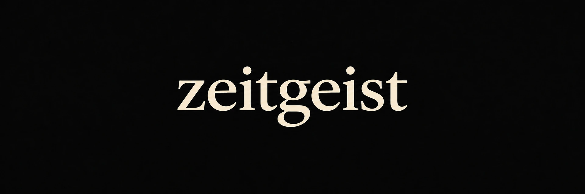

 

# Murad

**IT infrastructure specialist &nbsp;·&nbsp; Windows &nbsp;·&nbsp; Linux &nbsp;·&nbsp; Automation**

 

I run Windows and Linux servers, manage Active Directory and VMware, and script away repetitive work in PowerShell. I also build web tools for IT support and small utilities for everyday tasks.

 

 

---

## Stack

| Area | Tools |
|:--|:--|
| **Infrastructure** |    |
| **Automation & CI** |       |
| **Systems** |  |
| **Web development** |     |
| **Data** |   |

 

## Featured projects

### [zeit-claude-skills](https://github.com/zeitgeistz/zeit-claude-skills)

Claude Code skills with a shared `/zeit:` command prefix. They run project checks, review code, audit security, debug issues, and prepare releases.

`Claude Code` · `Skills` · `Security`

### [ServiceDesk](https://github.com/zeitgeistz/servicedesk)

A multi-tenant IT support app that brings ticket queues, SLA tracking, and asset inventory into one place, with an Active Directory sync agent.

`TypeScript` · `Next.js` · `Prisma` · `PostgreSQL`

### [IDM Auto Sorter](https://github.com/zeitgeistz/idm)

A Chrome and Edge extension that routes new downloads into folders by file type, domain, or URL rule. A dashboard shows download history and lets you edit the rules. A companion [PowerShell script](https://github.com/zeitgeistz/idm/blob/main/Organize-Downloads.ps1) sorts files already sitting in your Downloads folder.

`JavaScript` · `Chrome Downloads API` · `PowerShell`

 

---

 

**[Browse all repositories →](https://github.com/zeitgeistz?tab=repositories)**

 

**[LinkedIn](https://az.linkedin.com/in/murad-kamilli-6997b7389)**

 

